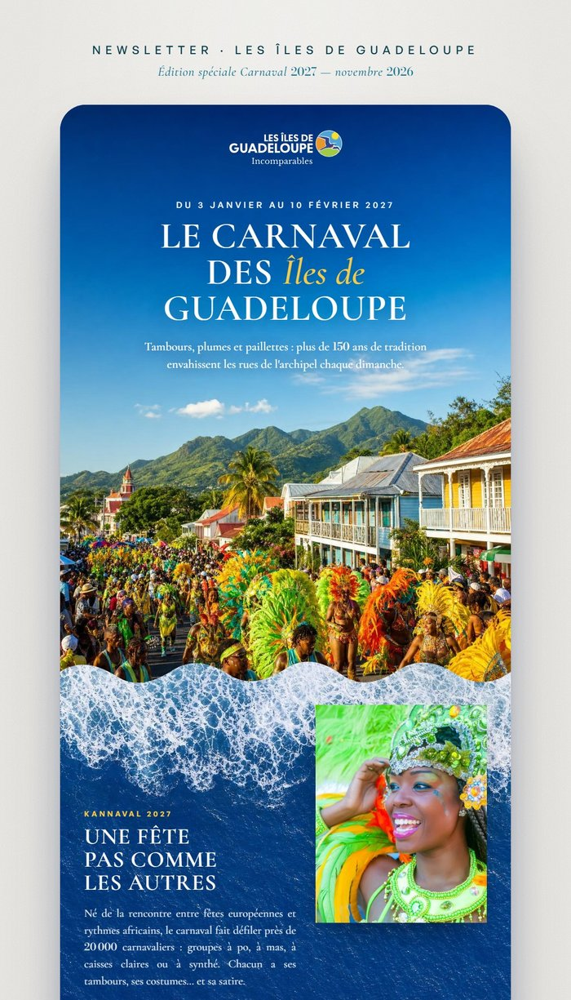

# Newsletter — Le Carnaval des Îles de Guadeloupe 2027

Projet pédagogique · Office de tourisme **Les Îles de Guadeloupe**

**🔗 Voir la newsletter en ligne : https://newsletter-carnaval-guadeloupe.vercel.app**

> Chaque modification enregistrée ici met le site à jour **automatiquement**, en 30 secondes environ.

---

## ✏️ Modifier un texte (2 minutes, rien à installer)

1. Cliquez sur le fichier **`index.html`** dans la liste ci-dessus.
2. Cliquez sur le **crayon ✏️** en haut à droite du fichier (*Edit this file*).
3. Faites **Ctrl + F** pour trouver la phrase à changer, puis modifiez **seulement le texte**.
4. Cliquez sur le bouton vert **Commit changes…**, écrivez en une ligne ce que vous avez changé, puis **Commit changes**.
5. Attendez environ 30 secondes et rafraîchissez le site.

💡 **Astuce** : sur la page du dépôt, appuyez sur la touche **`.`** (point) pour ouvrir un vrai éditeur (VS Code) directement dans le navigateur.

**À respecter dans le texte :**

| Code | Signification |
|---|---|
| `&nbsp;` | espace insécable (devant `:` `!` `?` `;` et `« »`) : à laisser |
| ` ` | retour à la ligne |
| `<i>…</i>` | mot en italique jaune dans les titres |
| `<b class="num">…</b>` | chiffre dans la police des chiffres |

Ne modifiez pas ce qui est entre `<` et `>`.

## 🖼️ Changer une photo

1. Ouvrez le dossier **`img`**, puis **Add file → Upload files**, glissez la photo et cliquez sur **Commit changes**.
   Photo en JPG ou WEBP, environ 1200 px de large, moins de 500 Ko, nom sans espace ni accent (ex. `defile-basse-terre.jpg`).
2. Dans `index.html`, remplacez l'ancien nom (ex. `img/tambour.webp`) par le nouveau, et mettez à jour le texte `alt="…"` juste à côté.
3. Pour recadrer : modifiez `object-position:50% 30%` (1er nombre = gauche/droite, 2e = haut/bas).

## 🧭 Où se trouve chaque partie dans `index.html`

Cherchez ces commentaires avec Ctrl + F, ils sont dans l'ordre d'affichage :

| Commentaire | Contenu |
|---|---|
| `<!-- ===== HERO ===== -->` | en-tête : logo, dates, titre — **texte validé, ne pas changer** |
| `<!-- Une fête pas comme les autres -->` | premier texte + photo |
| `<!-- Chiffres clés -->` | les 4 chiffres et leur source |
| `<!-- Histoire -->` | « Plus de 150 ans de liberté » |
| `<!-- Les familles de groupes -->` | à po, à mas, caisses claires, synthé |
| `<!-- Les jours gras -->` | programme du 7 au 10 février 2027 |
| `<!-- Toute la saison -->` | Reine, Lévé Pyjama, mariage burlesque, enfants |
| `<!-- Vivez-le de l'intérieur -->` | participer au carnaval |
| `<!-- Entre deux parades -->` | la destination, les îles |
| `<!-- Infos pratiques -->` | vol, décalage, climat, formalités… |
| `<!-- En images -->` | les 3 photos de fin |
| `<!-- Appel final -->` | « Bon kannaval ! » + bouton |
| `<!-- Pied de page -->` | réseaux sociaux + coordonnées |

## ✅ À faire / à vérifier

- [ ] Relire toute la newsletter avec le **PDF de consignes** (chiffres précis, textes concis, structure).
- [ ] **TikTok** : le compte n'apparaît pas sur le site officiel. Le lien pointe vers `tiktok.com/@ilesguadeloupe` : vérifier ou corriger (chercher `tiktok.com`).
- [ ] **Dates 2027** calculées d'après le calendrier (Dimanche Gras 7 févr., Lundi Gras 8, Mardi Gras 9, Mercredi des Cendres 10 ; saison dès le 3 janvier). À confirmer quand le programme officiel sortira.
- [ ] **Chiffres** : « ≈ 130 groupes » et « 20 000 carnavaliers » viennent d'une étude de 2012 (revue *Ethnologies*). « 100 000 spectateurs » est une estimation de la presse pour le Mardi Gras 2025. À remplacer si vous trouvez plus récent.
- [ ] **Images générées par IA**, à signaler si le prof le demande : `img/hero-ciel.jpg` (parade de l'en-tête) et `img/ocean-*.jpg` (fond de mer). Toutes les autres photos viennent du site officiel. Si l'en-tête est remplacé, prendre une photo verticale avec beaucoup de ciel en haut.
- [ ] Liens « Se désinscrire » et « Voir en ligne » : liens factices (`#`), normal pour un exercice.
- [ ] Garder la mention **« Projet pédagogique »** en bas de page (la newsletter utilise le vrai logo et les vraies coordonnées de l'office).

**À ne pas changer** : le texte de l'en-tête (logo, « Du 3 janvier au 10 février 2027 », le titre, la phrase « Tambours, plumes et paillettes… ») ni le fond ciel / montagnes / mer.

## 🎨 Couleurs et polices

Au début de `index.html`, dans `:root { … }` :

| Variable | Couleur | Usage |
|---|---|---|
| `--nuit` | `#0d3f4f` | bleu nuit officiel de l'office |
| `--ocean` | `#1d7691` | bleu officiel de l'office |
| `--soleil` | `#f9ca46` | jaune officiel (italiques, détails) |
| `--mer` | `#022b6b` | bleu de la mer (fond) |

Polices : **Cormorant Garamond** (titres et texte), **General Sans** (petites capitales, boutons), **Bodoni Moda** (chiffres).

## 📁 Contenu du dépôt

- `index.html` : la newsletter
- `img/` : les images (ne pas renommer le dossier)
- `version-1-one-page/` : première version, page web animée (facultative)
- `SOURCES.md` : d'où viennent les chiffres, les photos et les coordonnées

---

Logo, photos et coordonnées : Comité du Tourisme des Îles de Guadeloupe ([lesilesdeguadeloupe.com](https://www.lesilesdeguadeloupe.com/)), photographes Guillaume Aricique et Bruno Balmokoun. Projet réalisé dans le cadre d'un exercice, non diffusé par le Comité du Tourisme.
